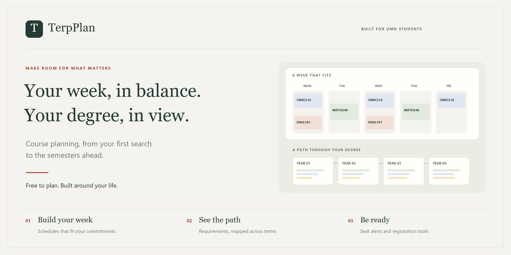

<a href="https://terpplan.com"></a>

<div align="center">

<p><sub>UNIVERSITY OF MARYLAND · INDEPENDENT STUDENT PROJECT</sub></p>

<h1>Make room for your life.</h1>

<p>Course and degree planning for UMD students.<br>
Build a week around your commitments, see the semesters ahead,<br>
and arrive at registration with a plan.</p>

<p><strong><a href="https://terpplan.com">Open TerpPlan ↗</a></strong> &nbsp; / &nbsp; <a href="https://terpplan.com/plan?demo=1">Try a sample</a> &nbsp; / &nbsp; <a href="docs/product-guide.md">Product guide</a> &nbsp; / &nbsp; <a href="#中文介绍">中文</a></p>

<p><sub>Free to use &nbsp; · &nbsp; English &amp; 中文 &nbsp; · &nbsp; No account needed to plan</sub></p>

</div>

---

## A little clarity, from week one to graduation.

TerpPlan connects the decisions that usually live in separate tabs: which course to take, where it fits in your week, what it counts toward, and what to do when the section is full.

### 01 &nbsp; Build your week

Search courses or instructors. Compare meeting times, reported seats, prerequisites, PlanetTerp reviews, and historical GPA. Generate up to three schedule options around your work, clubs, time preferences, and chosen sections. Keep Plan A and Plan B; compare compatible section swaps without rebuilding the rest of your week.

**[Open the planner →](https://terpplan.com/plan)** &nbsp; [Find an instructor](https://terpplan.com/instructor)

### 02 &nbsp; See the years ahead

Map **4–6 years** of courses across fall, spring, winter, and summer. Review credits, prerequisite order, Gen Ed progress, and major requirements. Read a uAchieve audit in your browser, explore a minor or second major, and find compact combinations for your remaining Gen Eds. Print an English degree plan to discuss with your advisor.

Computer Science has checks for the general track and four specializations. Other majors use the catalog's course tables; requirements written only as prose remain for your review.

**[Open the four-year plan →](https://terpplan.com/roadmap)** &nbsp; [Read an audit](https://terpplan.com/audit) &nbsp; [Explore another program](https://terpplan.com/minor)

### 03 &nbsp; Be ready to register

Send an eligible term from your roadmap into its semester plan, keeping existing courses and section choices. Compare schedules, prepare backups, and watch full sections. Optional seat emails group openings together; a registration checklist keeps course numbers and section numbers close at hand when Testudo opens.

**[Prepare for registration →](https://terpplan.com/register)** &nbsp; [See courses in demand](https://terpplan.com/hard-courses)

### 04 &nbsp; Take your plan into the day

Keep a daily class list and building links on your phone. Find a classroom between classes, export meetings to your calendar, or share a read-only schedule. Optional email sign-in syncs semester plans, your roadmap, Gen Ed choices, and preferences across devices.

**[Open My week →](https://terpplan.com/week)** &nbsp; [Find a study room](https://terpplan.com/rooms)

---

## Your plan. Clear boundaries.

Planning starts in your browser. **Degree-audit PDFs and full extracted text are not uploaded or retained.** The roadmap can keep a limited audit summary on this device; that summary does not sync to your account. Course lookups may send course codes and Gen Ed categories.

<details>
<summary><strong>What is saved, shared, and synced?</strong></summary>

| Your information | Where it goes |
| --- | --- |
| Semester plans, roadmap, Gen Ed choices, preferences | Saved in this browser; optional account sync includes personal commitment names, course codes taken, and registration times. |
| Roadmap audit summary | Only in this browser; clear it from the audit-check section. |
| Shared schedules and course calendars | Exclude personal commitments, email, and seat watches. Anyone with a schedule link can view it. |
| Device-transfer links | Carry semester plans, preferences, and courses taken, with event names removed; exclude the roadmap, Gen Ed selections, and audit summary. |
| Seat emails | Opt-in; stop them in the planner or through an alert email. |

The sample does not sync. Clearing this browser and deleting your account copy are separate actions. [Read the complete privacy and data notes →](docs/product-guide.md#privacy-and-data)

</details>

<details>
<summary><strong>Data sources and planning limits</strong></summary>

Courses and sections come from UMD/Testudo and umd.io; ratings, reviews, and historical grades come from PlanetTerp. In Now mode, classroom results combine Testudo schedules with today's UMD 25Live bookings for general-purpose rooms when fresh booking data is available. They describe scheduled availability, not live occupancy or guaranteed access.

Seat checks are scheduled every **2 minutes**. Seat emails are normally separated by at least **10 minutes**, combining openings that remain available. Backlogs, source data, and delivery can delay updates. Walking times, workload, catalog checks, and future offering patterns are estimates or partial checks.

TerpPlan is an independent student tool. Register in [Testudo](https://app.testudo.umd.edu/), and confirm degree requirements with your uAchieve audit and advisor. [Read the product guide →](docs/product-guide.md)

</details>

---

## 中文介绍

### 把眼前的一周，连到未来的毕业规划。

**TerpPlan 是为马里兰大学学生开发的免费选课与学位规划工具。** 从找课、排课、核对要求，到选课当天准备好班号和备选，让每一步都接得起来。

| 从哪里开始 | 可以做什么 |
| --- | --- |
| **[排好这一周](https://terpplan.com/plan)** | 按课程或教师找课，比较余位、评价与历史 GPA；围绕打工、社团和时间偏好生成方案，保留 A／B 计划，直接换班。 |
| **[看清未来几年](https://terpplan.com/roadmap)** | 安排 4–6 年课程，检查学分、先修、Gen Ed 和专业要求；读取审计、评估辅修／双专业，打印英文规划。 |
| **[准备选课](https://terpplan.com/register)** | 将支持的学期从四年规划转入排课，保留已有课程和班号；准备备选、关注余位，在注册清单中核对班号。 |
| **[带进每天的生活](https://terpplan.com/week)** | 手机查看课程与楼宇链接，找课间自习教室，分享或导出日历；邮箱登录后跨设备同步。 |

**默认本机保存，按需开启同步。** 审计 PDF 和完整提取文本不上传或保留；四年规划的精简审计摘要仅保存在本机，不同步到账号。课程查询可能发送课号和 Gen Ed 类别。账号同步包含个人日程名称；分享课表与课程日历不包含个人日程。

后台余位检查每 2 分钟触发，邮件通常至少间隔 10 分钟，将期间仍有余位的班次合并发送。空教室结果来自课表及“现在”模式下的公共教室当天预约，不代表实时占用或保证开门。正式选课在 Testudo 完成，毕业要求以审计和 advisor 确认为准。

[开始规划 ↗](https://terpplan.com) &nbsp; · &nbsp; [试用示例](https://terpplan.com/plan?demo=1) &nbsp; · &nbsp; [完整功能与隐私说明](docs/product-guide.md#中文介绍)

---

## For builders

TypeScript · React · Vinext · Tailwind CSS · Cloudflare Workers & D1 · PDF.js

<details>
<summary><strong>Run locally and check the project</strong></summary>

Requires **Node.js 22.13 or newer**.

```bash
npm install
npm run dev
```

```bash
npx tsc --noEmit
npm run lint
npm test
npm run build
```

The live app is published through GPT Sites. A GitHub push does not deploy the Site or its separate [seat-check Worker](workers/seat-cron/README.md). [Development details →](docs/product-guide.md#development)

The cover is an original product illustration. Its editable renderer is [included here](assets/readme/render_cover.py).

</details>

## Built with community knowledge

Thanks to [umd-course-recommender](https://github.com/wonder4hth/umd-course-recommender) for permission to use its degree-audit workflow as an early reference, and to the data sources that make informed student planning possible.

Feedback, a wrong room, or a requirement that needs attention? [Open an issue](https://github.com/Jul11us/terpplan-student-pilot/issues) or write to [terpplan@proton.me](mailto:terpplan@proton.me).

<div align="center">
<br>
<sub>Made for the semesters ahead. &nbsp; <a href="https://terpplan.com">terpplan.com ↗</a></sub>
</div>
