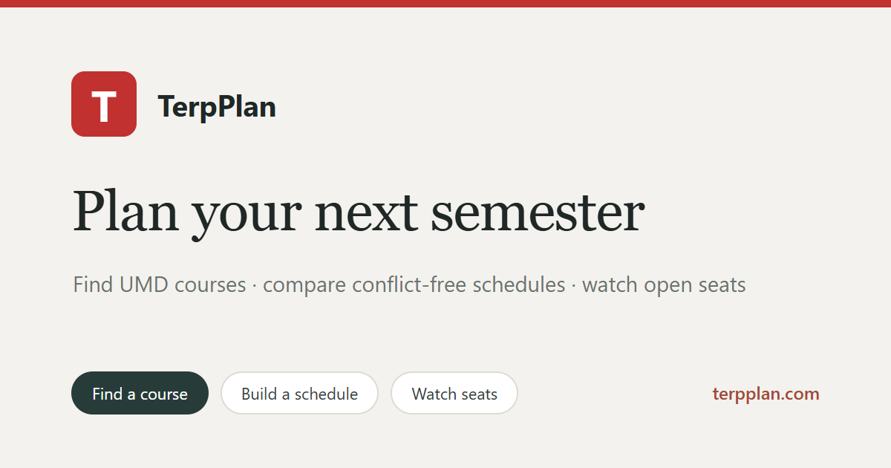

<div align="center">

<h1>TerpPlan</h1>

<p><strong>Plan your semester. Make room for your life.</strong><br>
A free course and degree planner for University of Maryland students.<br>
Build a week that fits, map your path to graduation, and get ready for registration.</p>

<p><a href="https://terpplan.com">Open TerpPlan</a> · <a href="https://terpplan.com/plan?demo=1">Try a sample plan</a> · <a href="#中文介绍">中文介绍</a></p>



<p>English &amp; 中文 · No account needed to plan · Optional email sign-in</p>

</div>

## From course search to registration day

TerpPlan brings course search, weekly schedules, four-year planning, degree-audit checks, and seat alerts into one place. Compare your options around the week you actually want: work shifts, clubs, later mornings, fewer campus days, or less walking between buildings. Then see how those courses fit into the semesters ahead.

It is an independent student tool, not an official UMD service. Final registration takes place in Testudo.

| Start here | What it helps with |
| --- | --- |
| [Course planner](https://terpplan.com/plan) | Find courses, compare sections, and build your weekly schedule. |
| [Four-year plan](https://terpplan.com/roadmap) | Arrange courses by term, check major and Gen Ed requirements, and print a degree plan. |
| [Degree audit](https://terpplan.com/audit) | Read a uAchieve PDF and find courses for unmet requirements. |
| [Minor & double-major explorer](https://terpplan.com/minor) | Estimate remaining requirements, prerequisites, and overlap. |
| [Instructor finder](https://terpplan.com/instructor) | Search by name and compare current sections, seats, ratings, and historical GPA. |
| [Hardest courses to get](https://terpplan.com/hard-courses) | See courses that remained nearly full in recent semesters and plan backups. |
| [My week](https://terpplan.com/week) | Keep a saved daily class list and building map links on your phone. |
| [Empty-classroom finder](https://terpplan.com/rooms) | Find rooms with no scheduled class, compare free time, and optionally sort by distance. |
| [Registration-day view](https://terpplan.com/register) | Open the course numbers, section numbers, and backups saved from your schedule. |

## What you can do

### Build a week that fits

- Search courses and Gen Ed categories; compare meeting times, reported seats, prerequisites, instructor ratings, and course-aware review excerpts from PlanetTerp.
- Generate up to three schedule options that avoid known time conflicts. Compare campus days, gaps, first classes, instructor ratings, and estimated walking time.
- Set preferred hours, avoid days, require or exclude sections, filter instructors, and optionally use only sections with open seats.
- Add weekly commitments such as work, lunch, or club meetings, and choose a minimum gap between classes. Lectures, discussions, and labs are checked together.
- Keep **Plan A and Plan B for each term**, with separate course lists and shared preferences.

Walking estimates use building locations and are approximate. They flag potentially rushed transitions and help rank options; the class buffer is a separate amount of time you choose. Missing courses and unknown meeting times are flagged for review.

### Fix conflicts and change sections

When a complete schedule cannot be found, see which course combinations, fixed sections, days, time limits, or commitments are blocking it. Suggested adjustments are backed by a schedule covering every course that would remain after the change. You decide which adjustment to apply.

Click a class in the timetable to compare compatible replacement sections, including their times, rooms, instructor ratings, seats, and effect on your week. Applying a replacement preserves the other selected section numbers and saves the new section as required in your plan.

### Connect your courses to your degree

Read a **uAchieve degree-audit PDF in your browser**. TerpPlan distinguishes completed courses, transfer-pass credits, and courses still in progress, then suggests courses for unmet requirements. Suggestions prioritize availability; historical average GPA is an optional comparison.

Explore a minor or double major using completed, in-progress, and planned courses. Compare remaining requirements, prerequisite paths, and possible overlap with your current major. Catalog requirements that cannot be represented as course rules are marked for your review.

### Map the semesters ahead

- Build a **4–6-year course plan** with fall, spring, winter, and summer terms. Include earlier AP or transfer courses, bring in saved courses, and move courses between terms.
- Track credits and Gen Ed progress, review prerequisite order, and flag courses recently offered only in fall or spring. Offering history is a planning hint, not a promise of future availability.
- Check Computer Science requirements for the general track or its cybersecurity, data science, machine learning, and quantum information specializations, with 45- and 75-credit review milestones. For other majors, choose the relevant catalog tables; rules available only as prose remain for you to check.
- Read an audit to compare the plan with its unfinished requirements. Add a suggested course directly to a term; full terms are disabled and missing prerequisite plans are marked.
- Print an English degree plan with term-by-term courses and requirement summaries for your own review or a conversation with your advisor.

These checks help you review a plan. Grades, GPA, permissions, residency, and conditions outside the modeled course rules still need confirmation with your audit and advisor.

### Fit remaining Gen Eds into your week

Choose the categories and counts you still need, including what you have already taken toward Diversity. Find compact course combinations that cover several requirements, taking account of eligible category overlap and cross-listed courses.

Use your existing plan, meeting times, and scheduling preferences when comparing combinations, or choose to explore without the current plan. Compare alternatives, replace a suggested course, and add the combination to your planner. Results use the selected term's available sections and your filters, within the planner's search limits.

### Find courses through an instructor

Search an instructor's name to see matching sections for the selected term, reported seats, PlanetTerp ratings, and historical average GPA. Open a course in the planner to compare its sections. The course list draws on that instructor's PlanetTerp history, so a course they are teaching for the first time may be missing.

### Prepare for demand and workload

Check recent offering history and courses that stayed nearly full to decide where you need backups or seat alerts. Historical seat counts describe observed availability; they do not predict whether you will get a place next term.

Review your credit total, daily class hours, and a rough semester workload estimate based on credits and historical course GPA. These are planning hints, not predictions of your grades or how much time you will need to study.

### Watch seats and act on an opening

Sign in to watch individual sections or a group of sections in a course. Seat changes appear while the planner is open; optional email alerts let you hear about openings when you are away. Opening links return to the planner, where available sections can be checked against your current saved schedule before you change it.

Background checks are triggered **every 2 minutes by Cloudflare Cron**, independently of GitHub Actions and whether your browser is open. With the background safety migration deployed, all callers share a maximum of 720 starts per UTC day, a 90-second minimum interval, and a persistent lease. Each run processes up to 200 watch rows / 100 course groups and sends up to 20 emails; larger backlogs take additional rounds. Source data and email delivery can lag, and a seat may fill before you act. See the [scheduler deployment guide](workers/seat-cron/README.md) for configuration and verification details.

### Be ready when registration opens

Save a registration checklist with course and section numbers, backup choices, and boxes to tick as you register. Enter your registration date and time to see a countdown and export a calendar reminder. Keep the registration-day page beside Testudo; after it has loaded online, its saved list can be reopened offline.

Use **My week** for a daily class list with building map links. Save your chosen schedule, open it online once, and add it to your phone's home screen for offline access. Fresh seats, course searches, and online maps still need a connection.

### Share, export, or continue on another device

- Share a read-only schedule link; meeting times and seats are refreshed when someone opens it. Shared schedules flag courses that could not be placed.
- Export class meetings to Apple Calendar, Google Calendar, or Outlook as an `.ics` file, or print your timetable. Calendar exports use UMD's academic calendar and Eastern time; final exams and meetings without usable times are excluded.
- Sign in with email to sync semester plans, the four-year roadmap, Gen Ed selections and remaining counts, preferences, courses taken, and registration times across devices. If both copies changed, choose which to keep.
- Use a device-transfer link to move your plans without signing in. It includes plan preferences and courses taken, so share it only with someone you want to see that information.

### Find a place to study between classes

Use the **empty-classroom finder** to search College Park buildings, check rooms now or at a selected weekday and time, and filter for at least 30 minutes, one hour, or two hours without a scheduled class. Optional browser location sorts buildings by distance and shows approximate walking times; coordinates are used in this browser. Breaks and holidays in the term calendar show no scheduled classes.

The results come from a dated Testudo class-schedule snapshot, not live occupancy or room reservations. Exams, events, locked doors, and building hours can still prevent access. A room listed as free is not guaranteed to be open.

## Privacy and data

| Information | How TerpPlan handles it |
| --- | --- |
| Degree-audit PDF and full extracted text | Read in your browser; neither is uploaded or retained. Selected course codes or Gen Ed categories may be sent for course lookups. |
| Roadmap audit summary | The roadmap saves a limited summary of unfinished requirement names, needs, course codes, and Gen Ed categories in this browser. It does not sync to your account and can be cleared from the audit-check section. |
| Minor / double-major progress | Calculated in your browser from the catalog snapshot. Optional planner account sync is separate. |
| Plans and preferences | Saved in this browser. Email sign-in enables account sync, including the roadmap, Gen Ed choices, personal commitments **and their names**, course codes taken, and registration times. Synced data is stored under a hashed account ID; you can delete the account copy while signed in. |
| Scheduling requests | Send course codes, section/instructor filters, preferences, and unnamed commitment identifiers and time intervals to the server. Personal event names are excluded from these requests. |
| Email address | Used for sign-in codes; saved for seat emails only when you turn them on. Alerts can be disabled in the planner or through an alert email. |
| Schedule sharing and calendar export | Personal commitments, email, and seat watches are excluded. Anyone with a shared schedule link can view it. |
| Device-transfer links | Include semester plans, preferences, and courses taken, with personal event names removed. The four-year roadmap, Gen Ed selections, and audit summary are not included. Anyone with the link can read the included information. |

The sample plan does not sync to your account. Clearing this browser and deleting a synced account copy are separate actions; another signed-in device can upload its copy again.

Course and seat information comes from UMD/Testudo and UMD.io; instructor ratings, reviews, and historical grades come from PlanetTerp. Confirm current availability, prerequisites, permissions, meeting times, and degree requirements with [UMD's Schedule of Classes](https://app.testudo.umd.edu/soc/) and your advisor. Planning estimates do not guarantee registration or degree completion.

## 中文介绍

**TerpPlan 是面向马里兰大学学生的免费选课与学位规划工具。** 从找课、排课、安排未来学期、核对毕业要求，到准备班号和备选清单，帮你把眼前的一周与毕业规划连起来。支持中英文；规划无需账号，邮箱登录后可跨设备同步。

- **找课与排课**：搜索课程和 Gen Ed 类别，比较班次、教师评价与余位，生成最多三个避开已知时间冲突的方案。支持指定／排除班次、筛选教师、避开某些日期和设置时间偏好。
- **个人日程与校园步行**：为打工、社团、午饭等固定日程留时间，设置课间最小间隔；查看楼宇间的粗略步行估算和赶课提示，也可优先选择少跑校园的方案。步行估算与自定缓冲是两项不同功能。
- **找空教室**：按楼名、时间和空闲时长筛选没有排课的教室，可选择定位并按距离排序。依据 Testudo 课表快照，不代表实时占用情况；考试、活动和门禁仍可能影响使用，假期没有排课也不保证楼宇开放。
- **冲突解法与直接换班**：解释哪些限制挡住了完整课表，为建议调整找到覆盖剩余课程的方案；在课表中比较兼容班次，只替换所选课程，保留其他已选班号。
- **Plan A／B**：每个学期保留两套课程计划，随时切换或复制，提前准备备选方案。
- **学位、辅修与双专业**：在浏览器中读取 uAchieve 审计，区分已修、转学分和在修课程；按余位优先推荐课程，估算辅修／双专业的剩余要求、先修路径与可能重叠。未能自动判断的目录要求需自行核对。
- **四年规划与专业要求**：按秋、春、冬、夏安排 4–6 年课程，记录 AP／转学分，检查学分、Gen Ed 和先修顺序，参考近期秋／春开课规律。支持 CS 普通方向及四个专业方向、其他专业的 catalog 表格和审计未完成要求核对；候选课可直接加入学期，也可打印英文规划。成绩、GPA、许可等条件仍需与审计和 advisor 确认。
- **Gen Ed 组合**：按各类别剩余门数和 Diversity 已修情况寻找紧凑的课程组合，可结合已有方案、班次时间与排课偏好，比较替代课后批量加入。考虑类别重叠与交叉列名；结果依据所选学期、可用班次和筛选条件，在限定搜索范围内生成。
- **找教师**：按姓名查看所选学期的班次、余位、PlanetTerp 评分与历史平均 GPA，再到排课器比较。课程依据教师的 PlanetTerp 历史，新教授的课程可能没有收录。
- **选课难度与学期负担**：参考近期仍接近满员的课程、开课历史、学分和每日上课时长；历史 GPA 只用于粗略负担提示，不代表你的成绩或学习时长。
- **余位与邮件提醒**：登录后关注单个班次或一组班次，选择是否开启邮件。后台由 Cloudflare Cron 每 2 分钟触发一次，每轮最多检查 200 行关注 / 100 个课程组；积压、源数据和邮件延迟都可能使实际提醒更晚。收到开位链接后，可在排课器里核对是否适合当前课表。
- **选课当天与离线查看**：保存课程号、班号、备选和勾选清单，设置选课倒计时与日历提醒。“My week”和已加载的选课清单可离线打开；新余位与在线地图仍需联网。
- **分享、导出与同步**：分享只读课表，导出 `.ics` 或打印；邮箱登录后同步学期方案、四年规划及 Gen Ed 选择。无需登录的迁移链接可转移学期方案、偏好和已修课程，不包含四年规划、Gen Ed 选择或审计摘要。

**隐私边界：** 学位审计 PDF 和完整提取文本不会上传或保留。四年规划会在本机浏览器保存未完成要求及课程编号的精简摘要，可单独清除，且不会同步到账号。计划默认保存在浏览器；登录同步时，四年规划、Gen Ed 选择、个人日程及其名称、已修课程代码和选课时间也会保存到账号。排课请求不发送日程名称，课表分享与课程日历不包含个人日程。设备迁移链接包含学期方案、偏好及已修课程，请谨慎分享；迁移时会去掉个人日程名称。

TerpPlan 是独立学生工具。正式选课在 Testudo 完成；余位、先修、许可和毕业要求请以 UMD 官方信息及 advisor 确认为准。

[开始规划](https://terpplan.com/plan) · [四年规划](https://terpplan.com/roadmap) · [学位审计](https://terpplan.com/audit) · [辅修与双专业](https://terpplan.com/minor) · [找教师](https://terpplan.com/instructor) · [最难抢的课](https://terpplan.com/hard-courses)

## Development

The web app uses TypeScript, React, Vinext, Tailwind CSS, Cloudflare Workers, and D1 with Drizzle ORM. Degree-audit PDFs are parsed on the client with PDF.js. A separate Worker in [`workers/seat-cron`](workers/seat-cron) provides the background seat-check schedule.

Requires **Node.js 22.13 or newer**.

```bash
npm install
npm run dev
```

Run the checks locally:

```bash
npx tsc --noEmit
npm run lint
npm test
npm run build
```

The live app is published through GPT Sites. Pushing this repository does not deploy a Site version or the Cron Worker. This repository has no GitHub Actions workflows; local validation commands remain available, and background seat checks run on Cloudflare Cron.

## Feedback

Found a wrong time, room, map link, or requirement? Use the report links in the app, [open a GitHub issue](https://github.com/Jul11us/terpplan-student-pilot/issues), or email [terpplan@proton.me](mailto:terpplan@proton.me).

## Acknowledgment

Thanks to the creator of [umd-course-recommender](https://github.com/wonder4hth/umd-course-recommender) for permission to use its degree-audit workflow as an early reference.
